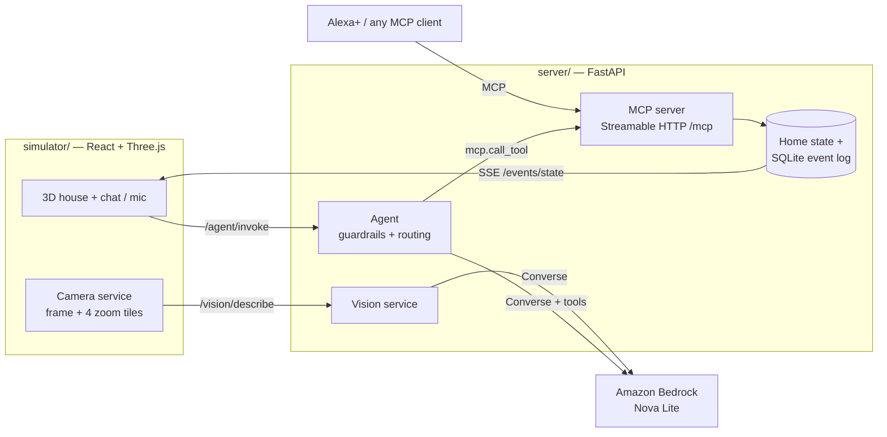

# AuraAssist — a context-aware home companion for Alexa+

AuraAssist is a **self-hosted MCP server** that lets an Alexa+ style assistant see,
remember and safely run a smart home, plus a **3D home simulator** that serves as
both the house and its cameras.

Ask *"where is my phone?"* and AuraAssist looks through the home's cameras with a
vision model, then tells you *"I can see your phone on the coffee table in the
living room."* Say *"prepare for bed"* and it reads back exactly what it will do
before touching anything. Unlocking the front door always needs an explicit "yes".

**Hackathon entry**

| | |
|---|---|
| **Primary track** | **Alexa+**: self-hosted MCP server, Streamable HTTP transport, protocol `2026-07-28` (official `mcp` Python SDK 2.3), plus a simulated Alexa+ experience in a web app |
| **Mini challenge** | **AWS Builder**: Amazon Bedrock (Converse API) with Amazon Nova Lite for tool-calling, vision and briefings |

---

## What it does

- **Controls the home through MCP tools only.** The voice agent, the 3D web app and any
  MCP client (Alexa+, MCP Inspector) all go through the same 8 tools, the same
  state and the same event log.
- **Sees the home.** The 3D simulator posts what each room camera shows. Nova Lite
  turns each frame into structured objects (`phone, on the coffee table`), and
  every object is stored as a text sighting, so *"where are my keys?"* works later.
  No images are stored.
- **Runs routines with a plan → approve → execute flow.** Bedtime, leaving home and
  morning routines first return a plan ("turn off 6 lights and close the curtains")
  and only run after the user approves.
- **Hard safety rules enforced in code, not in the prompt.** Unlocking and routine
  execution are downgraded to "plan only" unless the user's *current* message is an
  explicit approval. A stale plan can never be approved by a later "yes".
- **Honest by design.** If a camera hasn't seen a room yet, or the vision model
  fails, it says so instead of guessing.

## Architecture



### MCP tools (`server/mcp_tools.py`)

| Tool | Purpose |
|---|---|
| `get_home_snapshot` | Device state for the home or a room, with a ready-to-speak digest |
| `control_device` | On/off, brightness, temperature, TV volume/channel, doors, lock (unlock requires `confirm`) |
| `run_routine` | Plan (`confirm=false`) or execute (`confirm=true`) bedtime / leaving_home / morning |
| `get_recent_events` | What changed in the home, with repeated events grouped |
| `find_object` | Where an object was last seen, from vision sightings |
| `guide_to_object` | Non-visual directions to a found object: which surface, what it's next to, its height, and a walking route from the door (for people with low vision) |
| `describe_scene` | What a room camera currently sees: objects, locations, hazards |
| `generate_daily_briefing` | A calm daily summary; the caregiver version is only shared with the resident's consent |
| `set_user_preference` | Accessibility and privacy preferences |

### Where AWS is used (AWS Builder)

| File | Bedrock usage |
|---|---|
| `server/agent.py` → `invoke_bedrock` | Nova Lite via the **Converse API with `toolConfig`**: the model picks MCP tools, and the server enforces the safety guardrails |
| `server/vision.py` → `_bedrock_describe` | Nova Lite **multimodal**: one whole-room frame plus four zoomed tiles become structured JSON scene facts |
| `server/reasoning.py` → `briefing` | Nova Lite summarises the day's event log |

Everything also runs **offline in mock mode** (`AURA_USE_BEDROCK=0`): a deterministic
engine with the same tool contract, so the demo never depends on network access.

## Run it

**Requirements:** Python 3.10+, Node.js 18+. An AWS account is optional (only needed for real Bedrock).

### 1. Server

```bash
pip install -r requirements.txt
pip install boto3            # only for Bedrock mode
cp .env.example .env         # Windows: copy .env.example .env
python -m uvicorn server.main:app --port 8000
```

`.env` defaults to mock mode. For real Nova Lite, set `AURA_USE_BEDROCK=1` and add
AWS credentials. See [docs/aws-setup.md](docs/aws-setup.md) (about 5 minutes; check with
`python scripts/check_bedrock.py`).

Check it's up: `curl http://localhost:8000/health` reports `"agent_engine": "mock"` or `"bedrock"`.

### 2. 3D simulator

```bash
cd simulator
npm install
npm run dev
```

Open **http://localhost:5173**. The simulator finds the server on its own and
proxies to it. Press **A** (or click the assistant button) to chat, or use the mic.

### 3. Connect an MCP client (the Alexa+ path)

The MCP endpoint is **`http://localhost:8000/mcp`** (Streamable HTTP).

```bash
npx @modelcontextprotocol/inspector     # transport: Streamable HTTP, URL above
python scripts/smoke_mcp.py             # scripted MCP client: initialize, tools/list, tools/call
```

Every change made over MCP shows up live in the 3D house.

### Things to try

| Say / type | What happens |
|---|---|
| "what's happening?" | Spoken digest: security, climate, lights, curtains |
| "where is my phone?" | Looks through live camera views, then sighting memory |
| "what's on the coffee table?" | Vision answer from the living-room camera |
| "prepare for bed", then "yes" | Plan read back first, executed only after approval |
| "unlock the front door" | Refused until you confirm |
| "turn off the kitchen lights" | Direct device control, mirrored in 3D |

## Tests

```bash
cd simulator && npm test                 # 101 model/geometry checks
python scripts/smoke_vision.py           # vision + sighting memory (in-process)
python scripts/smoke_guidance.py         # non-visual directions (in-process)
python scripts/smoke_care.py             # caregiver consent rules (in-process)
# with the server running:
python scripts/smoke_mcp.py              # MCP over Streamable HTTP
python scripts/smoke_agent.py            # agent behaviour + safety rules
python scripts/smoke_vision_flow.py      # end-to-end object finding
```

## Repository layout

```
server/          FastAPI app, MCP server, agent, routines, vision, event store
scripts/         Bedrock check, terminal chat, smoke tests
docs/            AWS setup guide
simulator/       React Three Fiber 3D home (the house and its cameras)
  src/three/       rooms, furniture, appliances
  src/services/    server connection, SSE bridge, camera capture
  src/ui/          HUD, chat panel, device panels, reports
```

## Privacy

Camera frames are analysed and then dropped. Only text sightings ("phone, on the
coffee table, 12:45") are kept in the local SQLite log. The assistant reports
device facts and never infers who is home or anything about people's health.

## License

[MIT](LICENSE)
