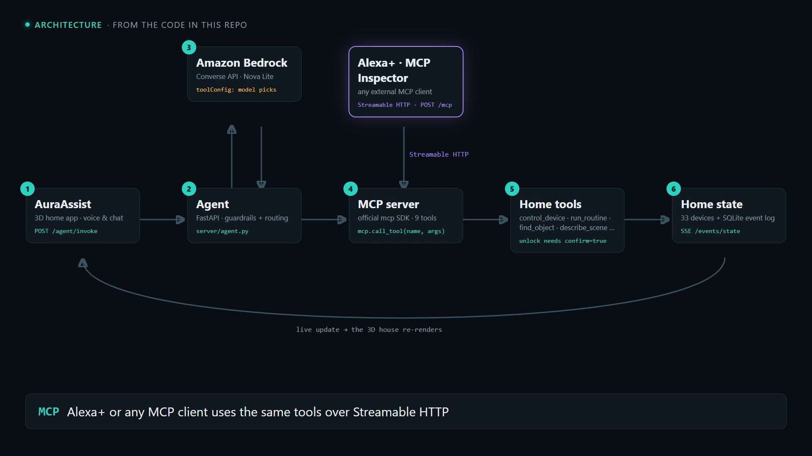
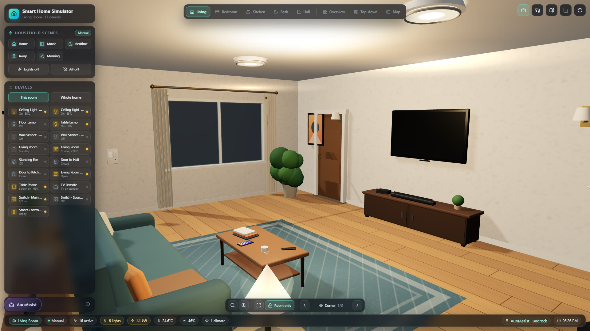
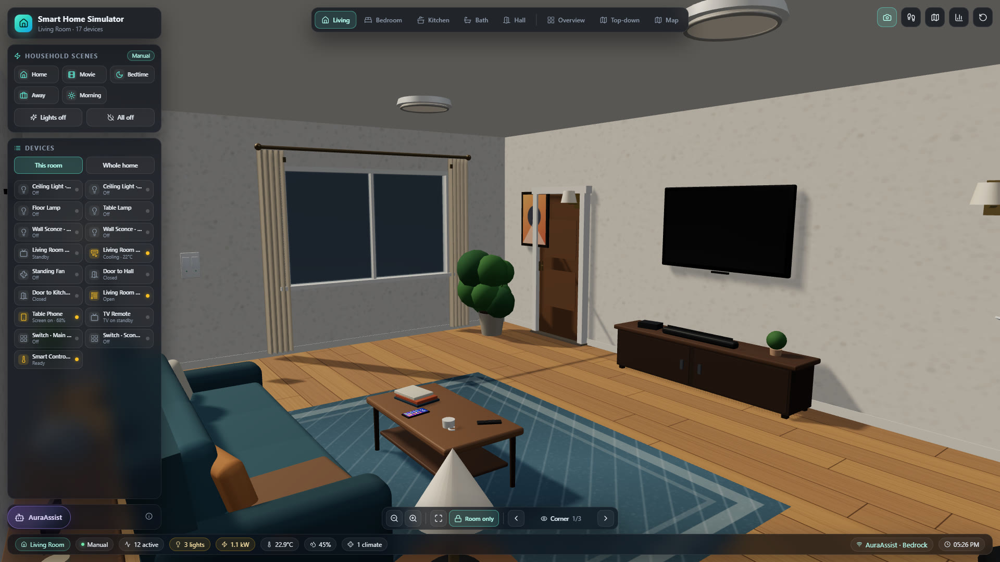

  <picture>
    <source media="(prefers-color-scheme: dark)" srcset="images/logo/auraassist-logo-dark.png">
    
  </picture>

> **Download:** [AuraAssist-Project-Description.pdf](AuraAssist-Project-Description.pdf) (7 pages, print-ready)

# AuraAssist: Project Description

**A context-aware, hands-free home companion for Alexa+**

AuraAssist helps people understand their home, find their belongings and manage daily
routines. It combines conversation, multimodal AI on Amazon Bedrock, and smart-home
workflows that ask for confirmation before acting.

Amazon "Build, Ship, Shape" Developer Hackathon · Alexa+ Track · AWS Builder Mini Challenge
Repository: https://github.com/Alagapie/aura-assist

---

## 1. Executive Summary

AuraAssist is a context-aware, hands-free home companion that makes a smart home easier
to understand and run. It is designed for people with low vision, people with limited
mobility, older adults, and family caregivers.

Traditional smart-home assistants expect users to remember device names and issue one
command per action. With AuraAssist, a user can:
- ask what is on a table
- ask where an item was last seen, and get non-visual directions to it
- ask what changed in the home
- ask the assistant to prepare the home for bed

The assistant looks up the relevant home context, chooses the right tools, reads back a
plan before acting on anything significant, and reports the result in short,
voice-friendly language.

The working prototype has four parts:
- a **self-hosted MCP server**: 9 tools over **Streamable HTTP** at `/mcp`, MCP protocol
  `2026-07-28`, official MCP Python SDK 2.3
- **Amazon Nova Lite on Amazon Bedrock**, for choosing tools, vision and briefings
- a **3D web home simulator**, which is both the house and its cameras
- a **SQLite event store**

Everything also runs in a deterministic offline mode with the same tool contract, so the
demo is repeatable without network access.

## 2. The Problem

A smart home is hard to use when it depends on visual dashboards, exact device names or a
chain of individual commands. For someone with low vision or limited mobility, knowing
that a light can be switched on is not enough. They also need to know what is in a room,
find a misplaced object, check whether the front door is locked, or review the day
without navigating screens.

Everyday questions include:
- "What's on the coffee table?"
- "Where are my glasses?"
- "Which lights are still on?"
- "What changed in the house today?"
- "Prepare the house for bed."

AuraAssist brings environmental context, device state, event history and routines into
one conversation.

## 3. The Solution

AuraAssist is a conversational layer over a simulated smart home. All reading and
control of the home goes through the MCP server: the in-app agent, the 3D web app and any
MCP client (Alexa+, MCP Inspector) share the same tools, the same state and the same
event log.

When a user speaks or types in the simulator, Amazon Nova Lite (through the Bedrock
Converse API with tools) decides which MCP tools to call. The server runs them, checks
safety rules in code, updates the home and streams the change back to the 3D house live.

## 4. Core Capabilities

### 4.1 Scene description
A user can ask what a room camera sees. Every room in the 3D house works as a camera. The
simulator sends a whole-room frame plus four zoomed tiles, and Nova Lite turns them into
structured objects, each with the surface it is on and a confidence score, plus any
hazards.
- If a camera has not seen a room yet, or the vision call fails, AuraAssist says so
  instead of guessing.
- The fridge has no camera feed, so its contents come from a simulated scene.

### 4.2 Object finding with memory
Every object the cameras recognise is stored as a text sighting (for example "phone, on
the coffee table, 12:45"). "Where are my keys?" first checks the live camera views, then
falls back to sighting history and gives the location and time last seen.

### 4.3 Non-visual guidance for people with low vision
Once an object is found, the `guide_to_object` tool gives directions that don't rely on
sight:
- which surface it is on, and how to tell that surface apart using landmarks (window,
  door, which side of the bed)
- what it is next to, and its height
- a walking route from the room's door

The prompt deliberately avoids "left" and "right", because they depend on which way the
person is facing.

### 4.4 Home-state awareness
The simulated home has **33 devices across 5 rooms** (living room, bedroom, kitchen,
bathroom, hallway):
- lights, doors, curtains and fans
- air conditioners with temperature control
- TV, fridge, cooker and shower
- a front-door lock, a doorbell and a sensor

"What's happening?" returns a short spoken summary grouped by security, climate, lights
and curtains, put together in code from verified state.

### 4.5 Multi-step routines: plan, approve, execute
Bedtime, leaving-home and morning routines first return a plan, for example "turn off 6
lights and close the curtains", including exceptions such as an unlocked front door. They
only run after the user says yes. A pending plan is cleared once the conversation moves
on, so a later "yes" can never approve a stale plan.

### 4.6 Event timeline and daily briefing
The event log records device changes, routine runs and object sightings.
`get_recent_events` groups repeated events into a short summary instead of a long list.
`generate_daily_briefing` summarises the day in two calm sentences, rewritten by Nova
Lite.

### 4.7 Consent-gated caregiver summary
A family caregiver gets a summary only when the resident has set the consent preference.
- The summary is deliberately narrow: routines, the front door and safety alerts.
- It never includes camera content, object sightings, or guesses about health or mood.
- Without consent, the request is refused and the refusal is recorded in the log.

### 4.8 Voice-first interaction
The simulator supports push-to-talk, a wake word and spoken replies through the browser's
Web Speech API. Voice needs Chrome or Edge; typing works in any browser. Replies are
short and conversational by design.

## 5. How It Works

1. The user speaks or types a request in the 3D simulator.
2. The simulator sends it to the AuraAssist server (`POST /agent/invoke`).
3. The agent passes the request and the 9 MCP tool definitions to **Amazon Nova Lite**
   through the Bedrock **Converse API** (`toolConfig`). The model chooses which tools to
   call.
4. Each tool call runs through the **MCP server's own dispatch**, the same tools that
   external MCP clients reach over Streamable HTTP.
5. The tools read or change home state, record events, or run vision on the latest
   camera frame.
6. The state change streams back to the 3D house live (Server-Sent Events), and the user
   gets a short spoken reply.
7. Unlocking the door and running routines are downgraded to "plan only" by code unless
   the user's current message is an explicit approval.

If Bedrock is unreachable, the agent falls back to the offline engine, so the home keeps
working.

| Before | After |
|---|---|
|  |  |

*A real Bedrock turn. "Turn off the living room lights": Nova Lite chose six `control_device` calls through the MCP server, and the house updated live.*

## 6. Technical Architecture

| Component | Role |
|---|---|
| 3D web simulator (React, Three.js) | The house, its room cameras, chat and voice UI. It also includes a browser MCP client that shows the raw MCP handshake and tool calls |
| Agent (FastAPI, `server/agent.py`) | Sends requests to Nova Lite with the MCP tools, and enforces safety rules in code |
| MCP server (`server/mcp_tools.py`) | 9 tools over Streamable HTTP at `/mcp`, MCP protocol `2026-07-28` |
| Amazon Bedrock: Nova Lite | Choosing tools (Converse + `toolConfig`), multi-image vision, daily briefing |
| Home-state service | 33 simulated devices; live updates to the simulator |
| Event store (SQLite) | Device changes, routine runs, object sightings, briefings |
| Routine planner | Bedtime / leaving-home / morning plans; plan → approve → execute |
| Offline engine | Deterministic engine with the same tool contract, for tests and offline demos |

**MCP tools:** `get_home_snapshot`, `control_device`, `run_routine`,
`get_recent_events`, `find_object`, `guide_to_object`, `describe_scene`,
`generate_daily_briefing`, `set_user_preference`.

**Tests:**
- Six smoke suites: MCP over Streamable HTTP, agent behaviour and safety rules, vision,
  guidance, caregiver consent, and object finding end to end.
- 101 simulator checks.
- All pass on a fresh clone.

## 7. Safety, Privacy and Responsible Design

- **No facial recognition or identification.** The vision step reports objects and
  hazards. For people, it reports only a count.
- **Images are not stored.**
  - The latest frame from each camera is kept in server memory so it can be analysed.
  - It is replaced by the next frame and cleared on reset or restart, and never written
    to disk.
  - Frames are sent to Amazon Bedrock for analysis.
- **Only text is kept.** Sightings and events are stored in a local SQLite file
  (`data/aura.db`) on the machine running the server. The prototype has no automatic
  retention limit: the log grows until the file is deleted.
- **Confirmation in code, not the prompt.** Unlocking needs `confirm=true` and an
  explicit approval in the current message. Routines always show their plan first.
- **Honest about uncertainty and failure.** Objects carry confidence scores. Rooms not
  yet seen are reported as unseen. A failed action is reported as failed, never as done.
- **Consent for caregivers.** Nothing is shared without the resident's consent
  preference, and camera content is never shared.
- **Scope.** AuraAssist is an assistance prototype. It is not an emergency-response,
  medical or fall-detection system.

## 8. Intended Users and Potential Impact

| Intended users | Potential benefit |
|---|---|
| People with low vision | Spoken scene descriptions, object finding, and non-visual directions to the object |
| People with limited mobility | One request runs a whole routine instead of many separate commands |
| Older adults | Simple spoken checks of the home and what changed |
| Family caregivers | Narrow, consent-gated summaries of home activity |
| Smart-home users | Contextual questions and coordinated control across many devices |

## 9. What Makes AuraAssist Different

AuraAssist is built around context and coordination, not a list of unrelated voice
commands:
- **Everything goes through MCP.** The model chooses real MCP tools, so the agent, the
  web app and any MCP client go through one set of tools, one state and one event log.
- **Safety and honesty are enforced in code.** Nothing depends on how well the model
  follows instructions.
- **Seeing turns into memory.** Camera views become text sightings, which become
  directions a blind or low-vision user can follow.

## 10. Current Prototype and Future Direction

**Runs end to end today:**
- the MCP server over Streamable HTTP
- Nova Lite choosing tools, vision and briefings on Bedrock
- the 3D simulator with live state updates
- routines with approval
- object finding and non-visual guidance
- caregiver consent
- browser voice

**Simulated:** the home and its devices (no physical hardware), and the fridge camera's
contents.

**Not yet connected:** a physical Alexa+ device or commercial smart-home platforms. The
MCP server is the integration point for an Alexa+-style client, and the demo shows that
role with the web simulator and standard MCP clients.

**Next steps:**
- Connect to real smart-home platforms where APIs and permissions allow.
- Add a retention setting for the event log, and per-camera privacy controls.
- Improve accessibility settings, spoken feedback and multilingual support.
- Deploy the MCP server for remote Alexa+ clients.

## 11. Conclusion

AuraAssist shows how an MCP-based assistant on Amazon Bedrock can make a smart home more
accessible. It combines scene understanding, object memory, non-visual guidance,
home-state awareness and confirmation-gated routines in one conversation. It helps people
understand their surroundings, not just issue device commands, and it handles privacy,
safety and honesty in code.
